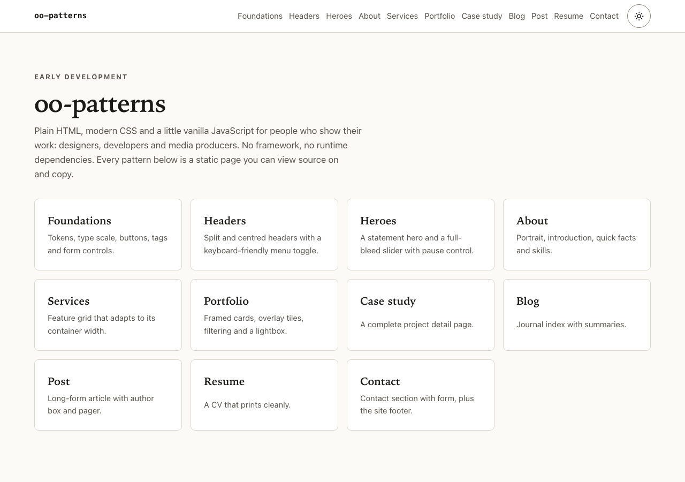
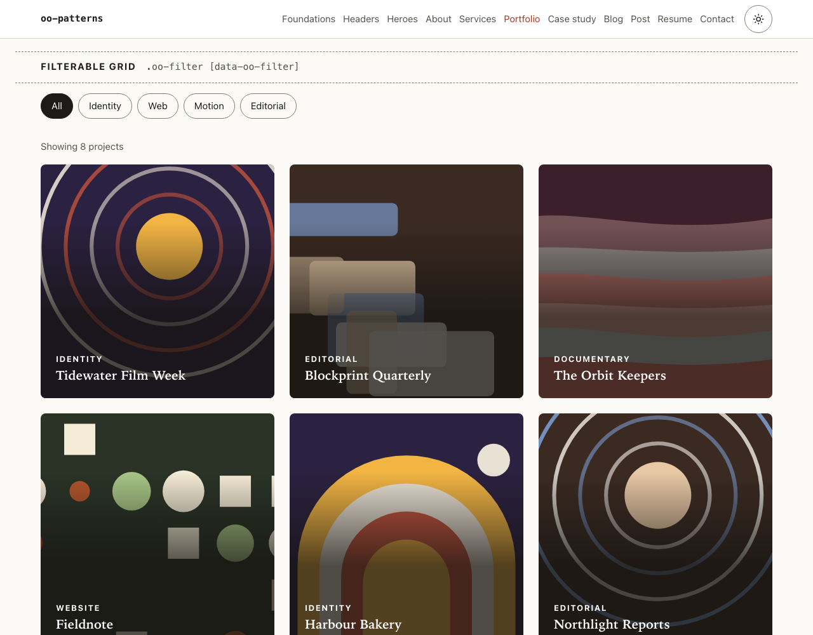
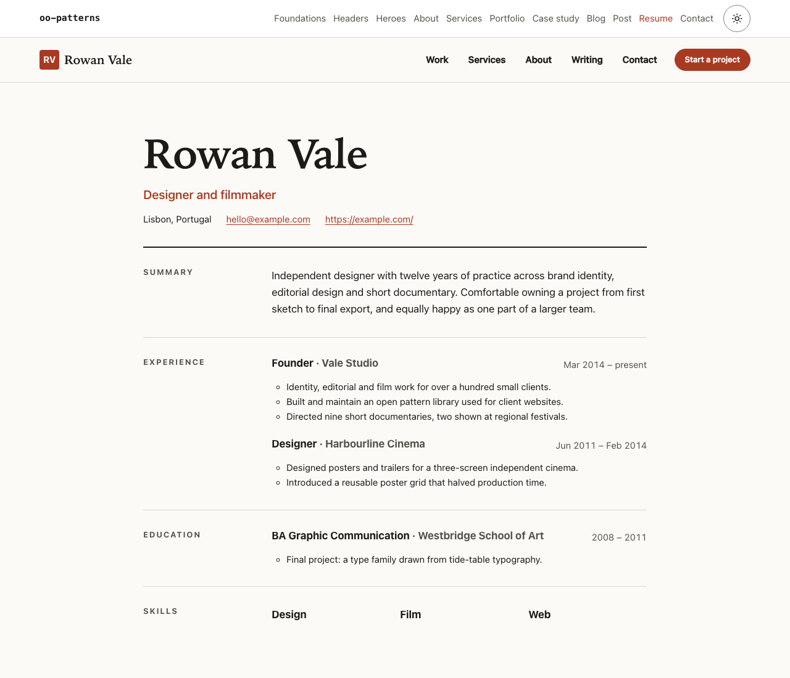
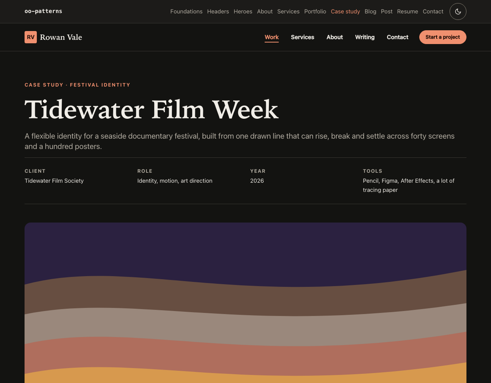
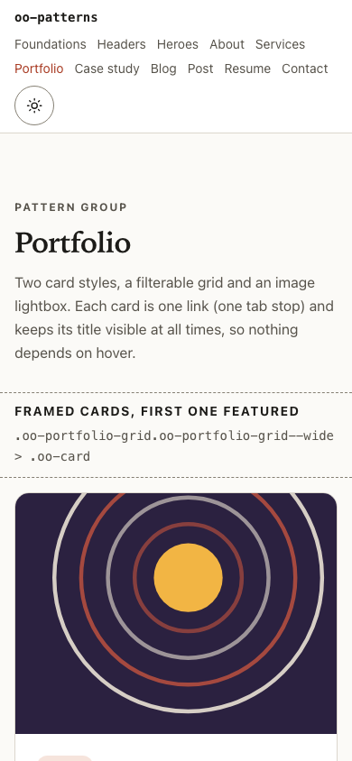

# oo-patterns

[](https://github.com/plutado/oo-patterns/actions/workflows/ci.yml)
[](https://github.com/plutado/oo-patterns/actions/workflows/pages.yml)
[](LICENSE)

A framework-agnostic library of HTML, CSS and small JavaScript patterns for personal and portfolio sites.

**Live demo: [https://plutado.github.io/oo-patterns/](https://plutado.github.io/oo-patterns/)**

**Status: early development.** The pattern set, class names and token names may still change before 1.0. See [ROADMAP.md](ROADMAP.md).

| Pattern index | Filterable portfolio grid |
| --- | --- |
| [](https://plutado.github.io/oo-patterns/) | [](https://plutado.github.io/oo-patterns/demo/portfolio.html) |
| **Resume / CV** | **Case study, dark theme** |
| [](https://plutado.github.io/oo-patterns/demo/resume.html) | [](https://plutado.github.io/oo-patterns/demo/case-study.html) |

<p align="center">
  <a href="https://plutado.github.io/oo-patterns/demo/portfolio.html"></a>
  <br>
  <em>Portfolio page at phone width (390 px).</em>
</p>

## What it is

oo-patterns is a set of ready-made page sections for people who show their work online: designers, developers, illustrators, photographers, filmmakers and other media producers. Each pattern is plain, semantic HTML styled by a shared set of design tokens. A few patterns are progressively enhanced with tiny vanilla JavaScript modules.

There is no framework, no build step required on the consuming side and no runtime dependency. Copy the markup, link the CSS, and optionally import a module.

Pattern groups:

| Group | Variants | JavaScript |
| --- | --- | --- |
| Foundations | tokens, typography, prose, buttons, tags, form controls | none |
| Headers and navigation | split, centred | `nav.js`, `theme.js` |
| Heroes | statement, slider | `carousel.js` (slider) |
| About | portrait with facts and skills | none |
| Services and features | container-query feature grid | none |
| Portfolio | framed cards, overlay tiles, filterable grid, lightbox gallery | `filter.js`, `lightbox.js` |
| Case study | full project detail page | `lightbox.js` (gallery) |
| Blog | post list, single post with author box and pager | none |
| Resume / CV | print-friendly CV | none |
| Contact and footer | contact section with form, site footer | none |

The full inventory, with class names and markup contracts, is in [docs/patterns.md](docs/patterns.md).

## Who it is for

- Individuals building or rebuilding a portfolio who want solid, accessible markup without adopting a framework.
- Developers theming a CMS (for example a Drupal theme) who want a pattern library that lives outside the CMS and can be tested on its own.

## Built with

- HTML and modern CSS: custom properties for design tokens, cascade layers, container queries, logical properties, `:has()`, native `<dialog>`.
- Vanilla JavaScript ES modules, no dependencies.
- Development tooling only: [Vite](https://vite.dev/) (demo site and build), [Vitest](https://vitest.dev/) with jsdom, [Stylelint](https://stylelint.io/), [html-validate](https://html-validate.org/) and [axe-core](https://github.com/dequelabs/axe-core).

Light and dark themes are built in. Motion is reduced or removed when the visitor has `prefers-reduced-motion` set. Colour tokens are tested for WCAG 2.2 AA contrast.

## Run the demo

Requires Node 20.19 or newer (developed on Node 22).

```sh
npm install
npm run dev          # demo site at http://localhost:5173
```

Other scripts:

```sh
npm run lint         # stylelint + html-validate
npm test             # vitest (components and token contrast)
npm run build        # library to dist/, demo site to dist/site/
npm run check:a11y   # axe-core over the built demo pages (run after build)
npm run preview      # serve dist/site/
npm run build:pages  # demo site built for https://plutado.github.io/oo-patterns/
```

The demo build uses relative URLs, so `dist/site/` works from any folder. Setting `OO_BASE` (for example `OO_BASE=/oo-patterns/`) makes asset URLs absolute under that path; the Pages workflow does this on every push to `main` and publishes `dist/site/`.

## Use it in a site

After `npm run build`, everything a site needs is in `dist/`:

```
dist/
  css/oo.css                 full bundle (tokens, base, components, all patterns)
  css/core.css               tokens, base and components only
  css/patterns/<name>.css    one file per pattern group
  js/oo.js                   autoInit() plus every component
  js/<component>.js          nav, carousel, filter, lightbox, theme
```

### CSS

Load the whole bundle:

```html
<link rel="stylesheet" href="/path/to/oo-patterns/css/oo.css">
```

Or load `core.css` plus only the patterns a page uses:

```html
<link rel="stylesheet" href="/path/to/oo-patterns/css/core.css">
<link rel="stylesheet" href="/path/to/oo-patterns/css/patterns/header.css">
<link rel="stylesheet" href="/path/to/oo-patterns/css/patterns/resume.css">
```

All library rules live in cascade layers (`oo.reset`, `oo.tokens`, `oo.base`, `oo.components`, `oo.patterns`). Any CSS you write outside a layer wins automatically, so overrides never need `!important`. To re-theme, override tokens:

```css
:root {
  --oo-color-accent: #2a5db0;
  --oo-font-display: "Fraunces", georgia, serif;
}
```

See [docs/design-tokens.md](docs/design-tokens.md) for the full token list.

### JavaScript

Every interactive pattern works without JavaScript; scripts add behaviour on top. The simplest setup wires everything by data attribute:

```html
<script type="module">
  import { autoInit } from '/path/to/oo-patterns/js/oo.js';
  autoInit();
</script>
```

Or import a single component:

```js
import { initFilter } from '/path/to/oo-patterns/js/filter.js';
initFilter(document.querySelector('[data-oo-filter]'));
```

To avoid a flash of the wrong theme when a visitor has chosen one, put this inline in `<head>` before the stylesheet:

```html
<script>try{var t=localStorage.getItem('oo-theme');if(t==='light'||t==='dark')document.documentElement.setAttribute('data-theme',t)}catch(e){}</script>
```

### Markup

Copy markup from the demo pages (`index.html` and `demo/*.html`); they are plain HTML with no templating. Each pattern's required structure is documented in [docs/patterns.md](docs/patterns.md).

## What's next

The roadmap totals about 98 hours of remaining work. The headline items, with rough estimates:

| Item | Estimate |
| --- | --- |
| More variants: overlay and off-canvas headers, video hero, pricing cards, list-style portfolio index, before / after comparison, testimonials | 28 h |
| Drupal theme integration examples: `libraries.yml`, Twig templates for page regions, portfolio nodes and articles, a Views-based filterable grid | 22 h |
| Real-browser testing with Playwright: axe-core in Chromium, Firefox and WebKit, screenshot tests in both themes, keyboard journey tests | 16 h |
| Documentation site: per-pattern pages with live example, copyable markup and class reference; generated token reference | 14 h |
| Theming guide with two or three alternate token sets and a demo theme switcher | 10 h |
| npm package: minified CSS, source maps, type declarations, release workflow with provenance, first tagged release | 8 h |
| **Total** | **98 h** |

Estimates are working hours for one person and include tests, docs and demo pages. The full breakdown is in [ROADMAP.md](ROADMAP.md).

## Documentation

- [docs/patterns.md](docs/patterns.md): pattern inventory and usage
- [docs/design-tokens.md](docs/design-tokens.md): tokens and theming
- [docs/integration-drupal.md](docs/integration-drupal.md): consuming `dist/` from a Drupal theme
- [docs/decisions/](docs/decisions/): architecture decision records
- [ROADMAP.md](ROADMAP.md), [CHANGELOG.md](CHANGELOG.md), [CONTRIBUTING.md](CONTRIBUTING.md)

## Browser support

Current versions of Chrome, Edge, Firefox and Safari (roughly 2023 and later). The library relies on cascade layers, container queries, `:has()` and `<dialog>`, which are all baseline in those browsers. Older browsers get readable, unstyled-but-usable content rather than a polyfilled experience.

## License

[MIT](LICENSE) &copy; 2026 David Fugate
